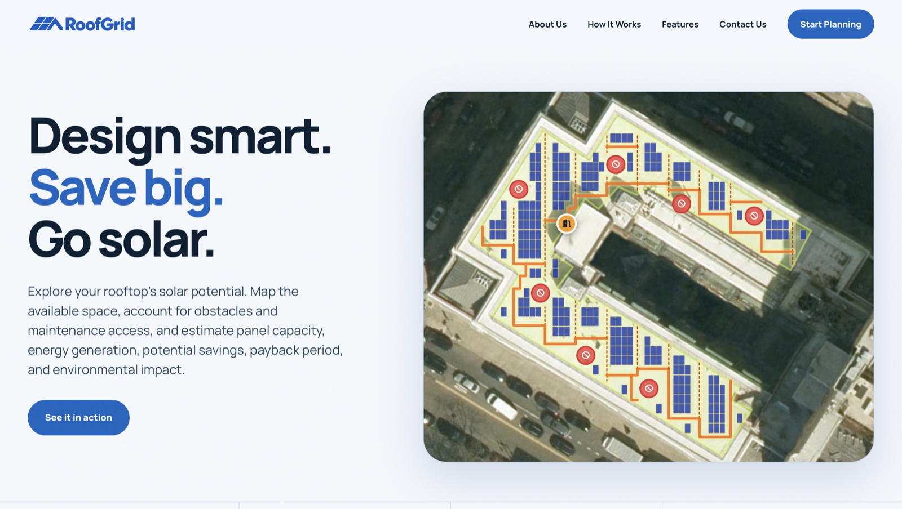
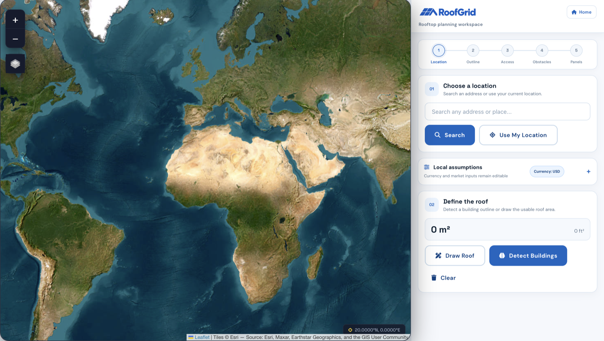
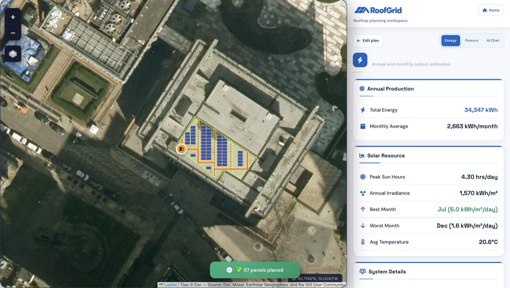
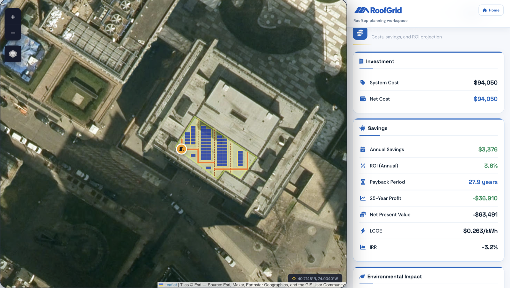
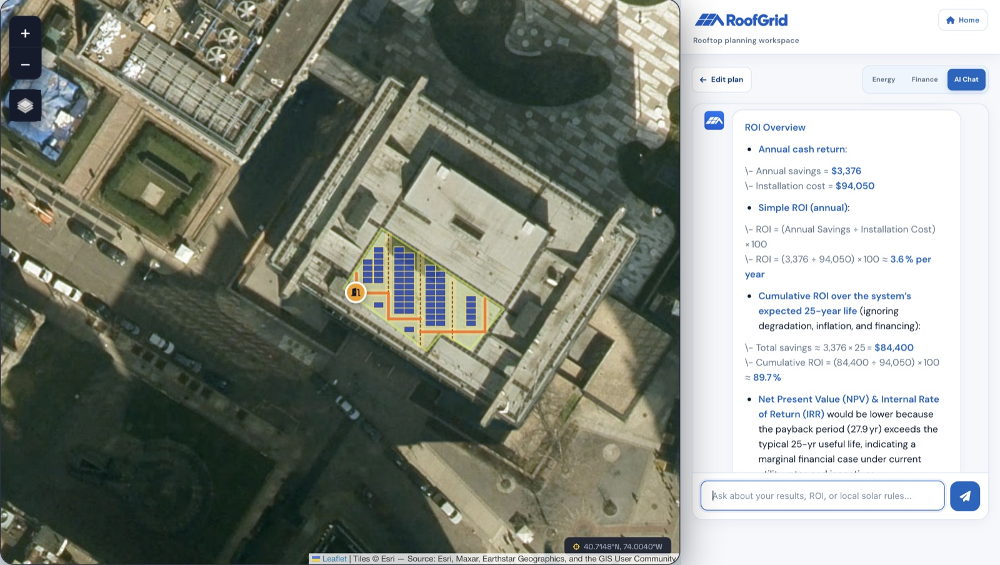
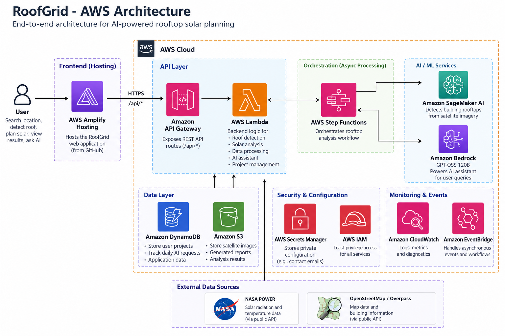

<p align="center">
  
</p>

<p align="center">
  <strong>Turn a real rooftop into a practical, access-aware solar plan—powered by AWS.</strong>
</p>

<p align="center">
  Locate a roof, map usable space, place panels, and explore energy, financial, environmental, and AI-assisted insights in one workflow.
</p>



## Why RoofGrid

Early solar estimates often start and end with a panel count. RoofGrid adds the real constraints that determine whether a rooftop plan is usable: roof geometry, access routes, maintenance space, obstacles, and editable local assumptions.

The result is an early-stage planning workspace that helps property owners, designers, students, and sustainability teams understand a roof's solar potential before moving to detailed engineering.

RoofGrid's application layer is built around AWS. Hosting, APIs, compute, orchestration, AI/ML, storage, security, events, and monitoring run on AWS. The only external data sources are map/building data and the NASA POWER public API.

## From rooftop to decision

1. **Locate** — search globally, use your current location, or navigate directly on the satellite map.
2. **Define** — detect a building footprint or draw the usable roof boundary yourself.
3. **Plan** — reserve rooftop access and maintenance paths, mark obstacles, and configure the panel layout.
4. **Estimate** — review expected generation, system size, cost, savings, payback, and environmental impact.
5. **Explain** — use the Amazon Bedrock-powered AI assistant to explore results and identify questions for local professionals.

### Find and define a rooftop



### Review energy potential



### Explore financial outcomes



### Ask questions about the plan



## Core capabilities

- Worldwide satellite mapping, address search, and GPS support
- OpenStreetMap building-footprint detection and manual roof drawing
- Access points, maintenance paths, and obstacle exclusion zones
- Configurable panel dimensions, spacing, orientation, and layout density
- NASA POWER solar-resource and temperature data with bundled regional fallbacks
- Editable currency, tariffs, export credit, installation cost, usage, and grid-emissions assumptions
- Energy, financial, and environmental estimates in one planning workspace
- Amazon Bedrock-powered AI assistant
- Downloadable project reports
- AWS-native serverless scaling, workflow orchestration, security, and monitoring

## AWS architecture



A request begins in the web application hosted by **AWS Amplify Hosting**. Amplify sends the browser's `/api/*` calls to **Amazon API Gateway**, which invokes **AWS Lambda** for backend processing.

Lambda coordinates rooftop-analysis workflows through **AWS Step Functions**. **Amazon SageMaker AI** performs rooftop detection from satellite imagery, and **Amazon Bedrock** powers the planning assistant. **Amazon DynamoDB** stores project and usage data, while **Amazon S3** stores imagery, reports, and analysis artifacts.

**AWS Secrets Manager** protects private configuration. **AWS Identity and Access Management (IAM)** provides least-privilege service permissions. **Amazon EventBridge** handles asynchronous events, and **Amazon CloudWatch** provides centralized logs, metrics, alarms, and diagnostics. Contact-form messages are delivered through **Amazon Simple Email Service (Amazon SES)**.

### AWS services used

| Layer | AWS service | How RoofGrid uses it |
| --- | --- | --- |
| Frontend | **AWS Amplify Hosting** | Hosts and continuously deploys the RoofGrid web application from GitHub. |
| API | **Amazon API Gateway** | Publishes the HTTPS `/api/*` interface, manages CORS, and applies request throttling. |
| Compute | **AWS Lambda** | Runs roof analysis, solar calculations, data processing, AI requests, contact handling, and project operations. |
| Orchestration | **AWS Step Functions** | Coordinates the asynchronous rooftop-analysis workflow and downstream AI/ML tasks. |
| Computer vision | **Amazon SageMaker AI** | Detects and analyzes building rooftops from satellite imagery. |
| Generative AI | **Amazon Bedrock** | Powers the AI assistant for questions, recommendations, and explanations of planning results. |
| Database | **Amazon DynamoDB** | Stores project metadata, application state, and daily AI-usage counters. |
| Object storage | **Amazon S3** | Stores satellite imagery, generated reports, and rooftop-analysis results. |
| Secrets | **AWS Secrets Manager** | Keeps private backend configuration outside the source code and frontend bundle. |
| Security | **AWS IAM** | Enforces least-privilege access between all AWS services. |
| Monitoring | **Amazon CloudWatch** | Captures logs, metrics, alarms, and runtime diagnostics. |
| Events | **Amazon EventBridge** | Routes asynchronous application events and workflow notifications. |
| Email | **Amazon SES** | Delivers contact-form messages through an AWS-managed email service. |
| Infrastructure | **AWS SAM and AWS CloudFormation** | Define, build, and deploy the serverless AWS infrastructure as code. |

### Request and data flow

```text
User
  |
  v
AWS Amplify Hosting
  |
  v
Amazon API Gateway
  |
  v
AWS Lambda
  |----> AWS Step Functions
  |         |----> Amazon SageMaker AI
  |         `----> Amazon Bedrock
  |
  |----> Amazon DynamoDB
  |----> Amazon S3
  |----> AWS Secrets Manager
  |----> Amazon SES
  |----> NASA POWER API
  `----> OpenStreetMap / Overpass

Amazon EventBridge carries asynchronous events.
Amazon CloudWatch captures logs, metrics, alarms, and diagnostics.
AWS IAM controls access between AWS services.
```

## External data sources

RoofGrid deliberately limits non-AWS dependencies to the data sources required for maps and solar-resource calculations:

| External source | Purpose |
| --- | --- |
| **OpenStreetMap / Overpass and map imagery** | Address and location context, satellite basemaps, and building-footprint information. |
| **NASA POWER** | Solar-radiation and temperature data used in energy-production estimates. |

All application hosting, API execution, compute, AI/ML inference, orchestration, persistence, object storage, email delivery, secrets, permissions, events, and monitoring are handled by AWS.

## Environmental impact and the SDGs

RoofGrid is designed to support better early decisions about distributed solar. It helps users compare how much clean electricity a rooftop may generate, understand whether a layout is practical, and estimate avoided grid emissions using transparent, editable assumptions.

This work aligns with four United Nations Sustainable Development Goals:

| Goal | How RoofGrid contributes |
| --- | --- |
| [SDG 7 — Affordable and Clean Energy](https://sdgs.un.org/goals/goal7) | Makes rooftop renewable-energy potential easier to explore and supports informed investment in solar generation. |
| [SDG 11 — Sustainable Cities and Communities](https://sdgs.un.org/goals/goal11) | Helps evaluate existing urban rooftops as distributed-energy sites while accounting for safe access and maintainability. |
| [SDG 12 — Responsible Consumption and Production](https://sdgs.un.org/goals/goal12) | Encourages efficient use of available roof area and exposes the material, energy, and financial assumptions behind a proposed system. |
| [SDG 13 — Climate Action](https://sdgs.un.org/goals/goal13) | Estimates potential avoided emissions so users can compare rooftop solar scenarios as part of broader decarbonization planning. |

RoofGrid reports estimated annual and lifetime energy generation, avoided CO₂e, and simple environmental equivalents. These values are decision-support estimates—not audited carbon accounting, verified emissions reductions, or certification of SDG performance.

In practical terms, the planner helps quantify:

- how much of a roof can be used without ignoring access and obstacle constraints;
- the renewable electricity a proposed layout may produce;
- the share of local electricity use that solar could cover; and
- the potential emissions avoided under an editable grid-emissions assumption.

## How the estimates are built

| Area | Source or method |
| --- | --- |
| Map and geometry | Map imagery, OpenStreetMap/Overpass building data, and browser-based geometry |
| Solar resource | NASA POWER API with bundled regional fallback data |
| Rooftop detection | Amazon SageMaker AI analysis of satellite imagery |
| Layout | Selected roof geometry, exclusions, access paths, obstacles, and panel settings |
| Energy | Solar-resource data combined with panel capacity, orientation, and editable system assumptions |
| Finance | User-editable cost, tariff, export-credit, usage, degradation, and discount assumptions |
| Environmental impact | Estimated generation multiplied by an editable grid-emissions factor |
| AI assistance | Amazon Bedrock through the AWS Lambda backend |
| Reports and artifacts | Amazon S3 |
| Project and usage data | Amazon DynamoDB |

## Repository layout

```text
.
├── index.html                  # Landing page
├── solar_advanced.html         # Interactive rooftop solar planner
├── privacy.html                # Privacy information
├── sw.js                       # Service worker
├── amplify.yml                 # AWS Amplify build configuration
├── aws/
│   ├── template.yaml           # AWS SAM / CloudFormation template
│   ├── deploy.sh               # AWS deployment helper
│   └── functions/app.py        # AWS Lambda API entry point
├── assets/
│   ├── architecture/           # AWS architecture diagram
│   ├── images/                 # Product and brand assets
│   └── screenshots/            # Application screenshots
└── data/                       # Bundled NASA POWER fallback data
```

## Deploy to AWS

**Live AWS deployment:** https://main.d5qymiq46yhlb.amplifyapp.com

### Prerequisites

- An AWS account
- AWS CLI configured with deployment permissions
- AWS SAM CLI
- GitHub access for AWS Amplify Hosting
- Access to the required Amazon Bedrock and Amazon SageMaker AI models or endpoints
- A verified Amazon SES identity for contact-form delivery

### 1. Configure private settings

Store the contact recipient in the `roofgrid/config` AWS Secrets Manager secret:

```json
{
  "CONTACT_EMAIL": "you@example.com"
}
```

AI access uses IAM roles and Amazon Bedrock, so no external AI API key is required.

### 2. Deploy the backend

From an authenticated AWS CloudShell or AWS CLI environment:

```bash
bash aws/deploy.sh
```

The deployment helper builds and deploys the AWS backend, configures the private setting, and verifies the health endpoint.

For a guided AWS SAM deployment:

```bash
cd aws
sam build
sam deploy --guided
```

Recommended production configuration:

```bash
AWS_REGION=ap-south-1 \
AI_DAILY_REQUEST_LIMIT=100 \
AI_THROTTLE_RATE=0.5 \
AI_THROTTLE_BURST_LIMIT=3 \
ALLOWED_ORIGIN=https://your-amplify-domain.amplifyapp.com \
AMPLIFY_APP_ID=your-amplify-app-id \
bash aws/deploy.sh
```

When deployment finishes, verify:

```text
https://YOUR_API_ID.execute-api.YOUR_REGION.amazonaws.com/api/health
```

The AI assistant uses:

```text
POST /api/ai
```

### 3. Deploy the frontend with AWS Amplify Hosting

1. Open AWS Amplify Hosting.
2. Connect `rohanmalhotracodes/roofgridxwemakedevs`.
3. Select the `main` branch.
4. Leave the monorepo option disabled.
5. Allow Amplify to use the root `amplify.yml`.
6. Configure the `/api/<*>` reverse proxy to the Amazon API Gateway URL.
7. Deploy the branch.

The browser uses same-origin `/api/ai`, `/api/contact`, `/api/nasa`, and `/api/overpass` routes. Amplify proxies them to API Gateway and Lambda.

### Updating the AWS deployment

AWS Amplify rebuilds the frontend after a push to its connected branch. Deploy backend changes separately:

```bash
cd aws
sam build
sam deploy
```

## Security and operations

- Never commit AWS credentials or private configuration.
- Store sensitive values in AWS Secrets Manager.
- Use IAM roles instead of long-lived API keys.
- Keep Amazon S3 buckets private and use scoped IAM policies.
- Restrict API Gateway and Amplify origins in production.
- Apply API throttling and daily AI-usage limits.
- Verify the required Amazon SES identity before enabling contact delivery.
- Review Amazon CloudWatch logs, metrics, alarms, and invocation errors.

## Planning limitations

- Satellite imagery and OpenStreetMap outlines may be incomplete, outdated, or misaligned.
- Production, cost, savings, payback, and emissions results depend on the assumptions entered by the user.
- Shade, structural capacity, electrical design, fire setbacks, permits, tariffs, and equipment availability require local verification.
- AI responses may be inaccurate and do not replace utility guidance, regulations, engineering, or professional advice.

RoofGrid is an exploration and planning tool—not an engineering design, structural assessment, permit set, installer quote, or carbon-accounting product.

## License

RoofGrid is available under the [MIT License](LICENSE).
